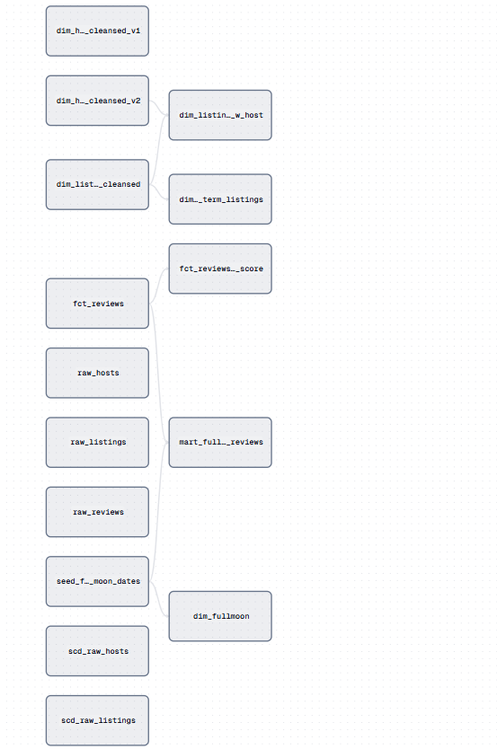

# Airbnb Analytics Pipeline · Dagster orchestration


Dagster project that orchestrates [dbt-airbnb-project](https://github.com/Arfat-khalid/dbt-airbnb-project), a dbt Core + DuckDB pipeline on Airbnb data for Berlin. Every dbt model, seed and snapshot becomes a Dagster asset with its lineage, the incremental fact table is split into **daily partitions** that can be backfilled one by one, and the rest of the project is materialised by a **daily schedule**.



---

## What it does

| Part | How |
|---|---|
| dbt → assets | `@dbt_assets` reads the dbt `manifest.json`; each model, seed and snapshot becomes an asset, and dbt tests run as part of each materialisation (`dbt build`) |
| Partitions | `fct_reviews` (incremental) is a separate asset with `DailyPartitionsDefinition`. Each partition passes its time window to dbt as `--vars '{"start_date": ..., "end_date": ...}'`, and the model loads only that day |
| Schedule | `materialize_dbt_models` builds all other assets every day at 00:00 |
| Metadata | A custom `DagsterDbtTranslator` adds `partition_expr` to the partitioned asset on top of the default dbt metadata |
| Configuration | The dbt project location comes from the `DBT_PROJECT_DIR` environment variable, with a default for the recommended folder layout |

---

## Tech stack

| Area | Tools |
|---|---|
| Orchestration | Dagster 1.13, dagster-dbt, Dagster UI (webserver) |
| Transformation | dbt Core 1.12, dbt-duckdb |
| Warehouse | DuckDB |

---

## Project structure

```
.
├── my_dbt_dagster_project/
│   ├── project.py        DbtProject: where the dbt project and profiles live
│   ├── assets.py         dbt assets, daily-partitioned fct_reviews, custom translator
│   ├── schedules.py      daily schedule for the dbt assets
│   └── definitions.py    Definitions: assets, schedules, dbt resource
├── docs/                 images for this README
└── pyproject.toml        dependencies and Dagster module
```

---

## Getting started

Requirements: Python 3.12, Git. Commands are for PowerShell on Windows.

**1. Clone both repositories into the same parent folder:**

```powershell
git clone https://github.com/Arfat-khalid/dbt-airbnb-project.git
git clone https://github.com/Arfat-khalid/dagster-airbnb.git
```

```
parent-folder/
├── dbt-airbnb-project/
└── dagster-airbnb/
```

If your dbt project lives somewhere else, create a `.env` file in the root of this repository (Dagster reads it automatically):

```
DBT_PROJECT_DIR=C:\path\to\dbt-airbnb-project
```

**2. Set up the dbt project** as described in its [README](https://github.com/Arfat-khalid/dbt-airbnb-project#getting-started): download and clean the raw data, then run `dbt deps`, `dbt seed` and `dbt build`. Dagster does not install dbt packages itself (`install_deps=False`).

**3. Install and start Dagster:**

```powershell
cd dagster-airbnb
python -m venv .venv
.venv\Scripts\Activate.ps1
python -m pip install -e .

dagster dev        # UI at http://localhost:3000
```

**4. Materialise assets** in the UI:
- **Jobs → materialize_dbt_models → Materialize all** builds everything except the partitioned fact table (the same job the daily schedule runs).
- Open `fct_reviews` → **Materialize** → **Show all partitions** → pick one or more days → **Launch backfill**. Partitions start on 2021-01-01; the review data ends in October 2021.

---

## Design decisions

- **Two `@dbt_assets` definitions.** `fct_reviews` is excluded from the main asset definition (`exclude="fct_reviews"`) and defined again with partitions. Without the exclude, Dagster rejects the duplicate asset key.
- **Seeds and sources appear separately.** In the dbt project, the raw tables are loaded as seeds (`raw_listings`, `raw_hosts`, `raw_reviews`) and read through dbt sources, standing in for an ingestion tool. Dagster treats the seeds and the sources as different assets and does not allow mapping both to the same key, so the raw seeds appear unconnected in the graph.
- **`install_deps=False`.** dbt packages are installed once with `dbt deps` in the dbt project, so starting Dagster never depends on reaching the dbt package hub.
- **`profiles_dir` points into the dbt project.** dagster-dbt looks for `profiles.yml` in `~/.dbt/` by default. The dbt project keeps its dev and prod targets in `_prod_profiles/profiles.yml` (relative DuckDB paths, no secrets), so Dagster uses the same file as local runs and CI.
- **`protobuf<7`.** Dagster 1.13's gRPC dependencies are not compatible with protobuf 7, so it is pinned in `pyproject.toml`.

---

## Related

- **dbt project:** [dbt-airbnb-project](https://github.com/Arfat-khalid/dbt-airbnb-project): models, tests, snapshots, documentation and CI/CD (slim CI on pull requests, prod deploy on merge).

---

## Credits

Built while completing *The Complete dbt Bootcamp: Zero to Hero* by Zoltan C. Toth and adapted to Dagster 1.13 (`DbtProject`, configurable project path). Data from [Inside Airbnb](https://insideairbnb.com/), licensed under [CC BY 4.0](https://creativecommons.org/licenses/by/4.0/).
